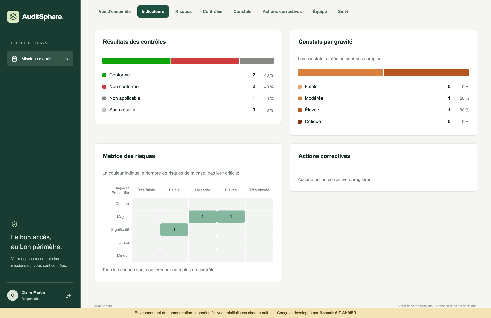
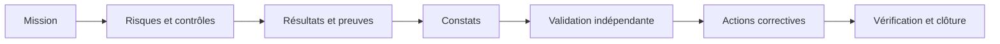
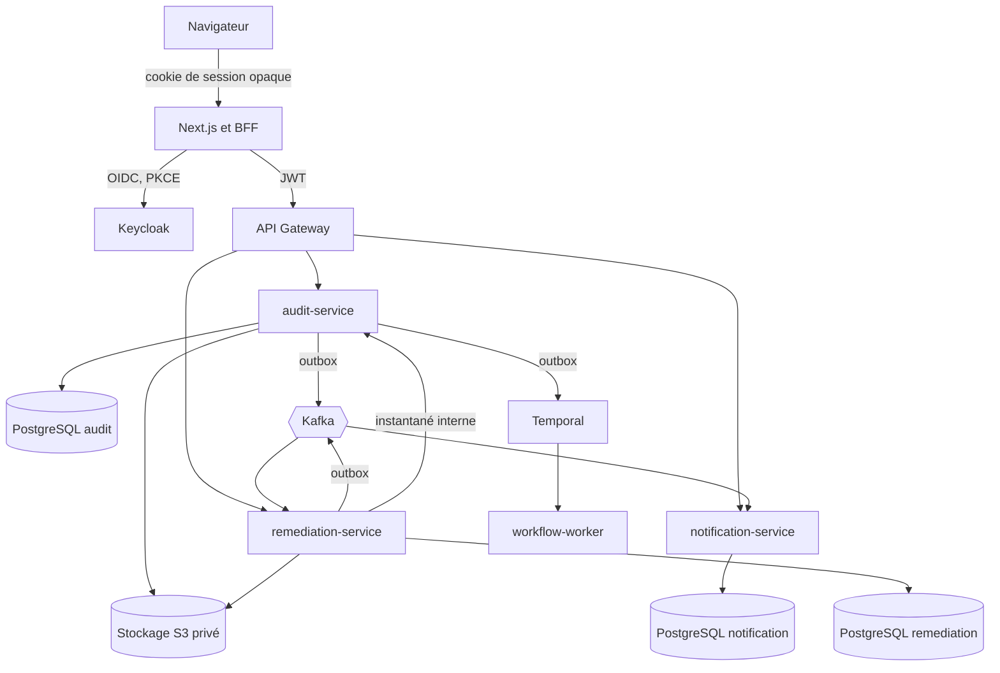
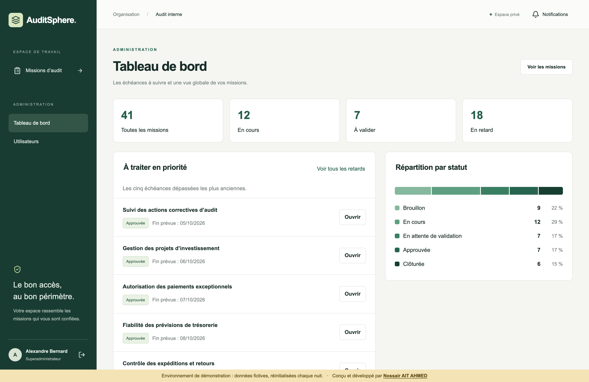
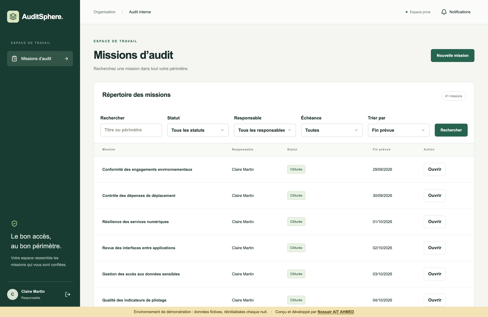
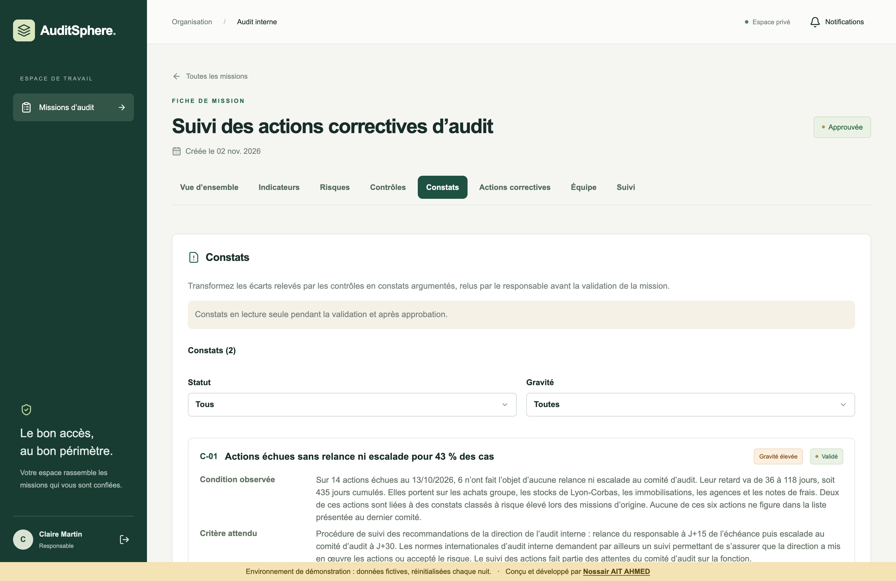
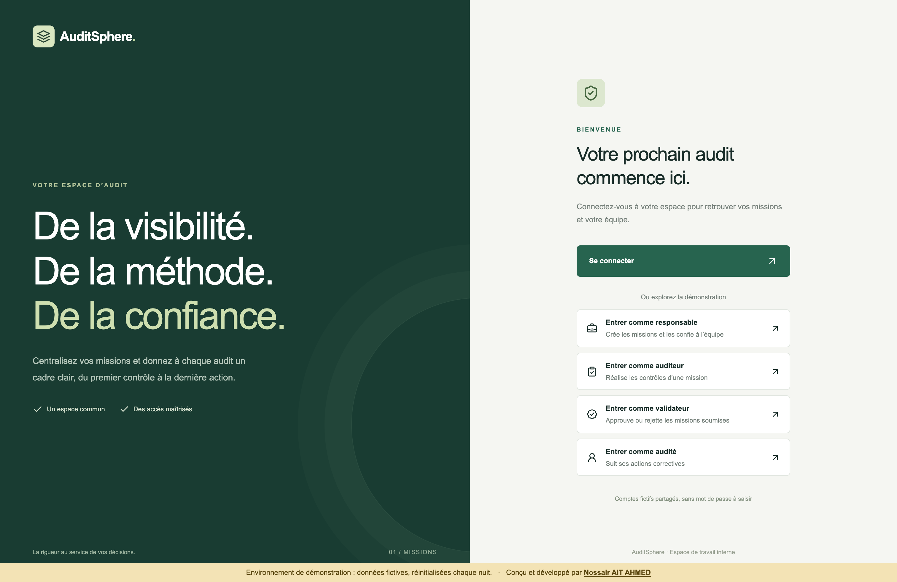

# AuditSphere

[](https://github.com/NossairAA/AuditSphere/actions/workflows/ci.yml)

**Plateforme d'audit interne en microservices, de la planification d'une mission jusqu'à la vérification des actions correctives.**

Projet personnel conçu, développé et exploité de bout en bout pour pratiquer les systèmes distribués sur un vrai métier : Spring Boot, Kafka, Temporal, sécurité OIDC, Kubernetes et observabilité. L'application tourne sur un cluster k3s, avec des données fictives.

**[Essayer la démo en ligne](https://auditsphereapp.online)** : entrée en un clic comme responsable, auditeur, validateur ou audité, sans compte à créer. Les données sont réinitialisées chaque nuit.



## En bref

| | |
| --- | --- |
| **Backend** | 4 services Spring Boot 4 et un worker Temporal, en Java 21 |
| **Frontend** | Next.js 16, React 19 et TypeScript, avec un BFF qui garde les jetons côté serveur |
| **Événements** | 5 topics Kafka versionnés, outbox transactionnelle, consommateurs idempotents |
| **Données** | Une base PostgreSQL 17 par service, 24 migrations Flyway, stockage objet S3 pour les preuves |
| **Tests** | Plus de 160 tests Java, 35 parcours Playwright, 25 tests Python, scénarios de panne en CI |
| **Livraison** | CI GitHub Actions, scan de secrets, Trivy bloquant, SBOM, images épinglées par empreinte |
| **Exploitation** | k3s, Helm, TLS interne, NetworkPolicies, Prometheus, sauvegardes chiffrées et restauration testée |

## Le problème traité

Une équipe d'audit interne disperse souvent son travail entre tableurs, emails et dossiers partagés. Le suivi des recommandations et la traçabilité en souffrent. AuditSphere réunit le parcours complet et impose ses règles côté serveur.



Le domaine impose de vraies contraintes techniques : cloisonnement par mission, séparation des fonctions, fichiers sensibles, validation humaine de longue durée et historique non réécrit.

## Architecture



Le document d'[architecture](docs/architecture.md) détaille les responsabilités, les flux et la cohérence entre services.

## Problèmes techniques résolus

### Publier un événement sans le perdre ni le doubler

Écrire en base puis publier dans Kafka peut échouer entre les deux. L'événement est donc inséré dans une outbox, dans la même transaction que le changement métier. Un publieur réserve les lignes avec `FOR UPDATE SKIP LOCKED` et un bail, libère la connexion avant l'appel à Kafka, puis marque la ligne après l'acquittement. Les consommateurs dédupliquent par clé, et les messages illisibles partent vers une file d'erreurs.

Code : [OutboxPublisher](services/audit-service/src/main/java/com/auditsphere/audit/OutboxPublisher.java), [AssignmentConsumer](services/notification-service/src/main/java/com/auditsphere/notification/AssignmentConsumer.java), [KafkaConfig](services/notification-service/src/main/java/com/auditsphere/notification/KafkaConfig.java).

### Faire survivre une validation humaine aux pannes

Une revue de mission peut durer des jours, pendant lesquels les services redémarrent. Chaque soumission crée un cycle et un workflow Temporal au nom stable, déclenché par une outbox dédiée. PostgreSQL reste la source de vérité des droits et des statuts. Temporal porte l'attente durable et la décision.

Code : [ReviewWorkflowImpl](services/audit-service/src/main/java/com/auditsphere/audit/workflow/ReviewWorkflowImpl.java), [ReviewWorkflowPublisher](services/audit-service/src/main/java/com/auditsphere/audit/ReviewWorkflowPublisher.java). Test de panne : [test-temporal.py](scripts/test-temporal.py).

### Ne jamais exposer de jeton au navigateur

Le navigateur ne reçoit qu'un cookie `HttpOnly` opaque. Les jetons restent dans une base dédiée au BFF, chiffrés en AES-256-GCM, et seul le hash de l'identifiant de session y est conservé. Le flux OIDC utilise Authorization Code, PKCE, state et nonce. Toute mutation exige une origine exacte et un jeton CSRF. Même le flux temps réel passe par cette session.

Code : [auth.ts](apps/web/src/lib/auth.ts), [session-crypto.ts](apps/web/src/lib/session-crypto.ts), [proxy.ts](apps/web/src/proxy.ts) pour la CSP à nonce.

### Faire respecter le métier dans l'API et en base

Les droits sont vérifiés à chaque requête, indépendamment de l'interface. Une ressource hors périmètre renvoie 404 pour ne pas révéler son existence. Le validateur ne peut pas être auditeur de la mission, y compris sous transactions concurrentes. La personne qui soumet un constat ne peut pas décider dessus. Les journaux sont en ajout seul, et un compte SQL applicatif ne peut pas réécrire l'auteur d'une opération.

Code : [MissionController](services/audit-service/src/main/java/com/auditsphere/audit/MissionController.java), [FindingController](services/audit-service/src/main/java/com/auditsphere/audit/FindingController.java), [harden-databases.py](scripts/harden-databases.py).

### Découper un service seulement quand c'est justifié

Les constats restent dans `audit-service`, car ils partagent le verrou et les permissions de la mission. Les actions correctives ont un service dédié : leur cycle de vie continue après la clôture de la mission et concerne d'autres utilisateurs. La synchronisation combine un événement et la lecture d'un instantané, avec reprise après redélivrance.

Code : [FindingsIssueConsumer](services/remediation-service/src/main/java/com/auditsphere/remediation/FindingsIssueConsumer.java), [IssueSnapshotClient](services/remediation-service/src/main/java/com/auditsphere/remediation/IssueSnapshotClient.java). Les autres arbitrages sont dans les [choix techniques](docs/choix-techniques.md).

### Tester les pannes, pas seulement les cas nominaux

La CI démarre la pile complète, arrête Kafka, Temporal, les workers et une base pendant des parcours réels, puis vérifie qu'aucune notification ni décision n'est perdue ou doublée.

Code : [test-notifications.py](scripts/test-notifications.py), [ci.yml](.github/workflows/ci.yml).

## Aperçu

| Tableau de bord | Répertoire des missions |
| --- | --- |
|  |  |

| Constats d'une mission | Connexion |
| --- | --- |
|  |  |

## Stack technique

| Domaine | Technologies |
| --- | --- |
| Backend | Java 21, Spring Boot 4, Spring Security, Spring Cloud Gateway, Spring Kafka |
| Données | PostgreSQL 17, Flyway, Garage compatible S3 |
| Asynchrone | Apache Kafka 4 en KRaft, Temporal, Server-Sent Events |
| Frontend | Next.js 16, React 19, TypeScript, openid-client, jose |
| Identité | Keycloak 26, OIDC, assertions JWT signées pour la démonstration |
| Contrats | OpenAPI 3, JSON Schema |
| Tests | JUnit 5, Testcontainers, Awaitility, Playwright, unittest |
| CI/CD | GitHub Actions, GHCR, Gitleaks, Trivy, SBOM CycloneDX |
| Infrastructure | Docker Compose, k3s, Helm, cert-manager, Cloudflare Tunnel |
| Observabilité | Prometheus, Alertmanager, OpenTelemetry, Grafana, Loki, Tempo |

## Lancer le projet

Prérequis : Docker, Python 3 et Node.js 24.

```bash
python3 scripts/init-local.py
```

```bash
sh scripts/start-local.sh
```

```bash
npm --prefix apps/web ci
```

```bash
npm --prefix apps/web run dev
```

Ouvrir http://localhost:3000. Le premier script génère des mots de passe aléatoires dans `.env`, qui n'est jamais versionné. Les comptes `manager`, `auditor`, `validator` et `superadmin` utilisent `MANAGER_PASSWORD`, `AUDITOR_PASSWORD`, `VALIDATOR_PASSWORD` et `SUPERADMIN_PASSWORD`.

## Limites assumées

Le projet privilégie la profondeur technique, sans prétendre à une production critique.

- Le cluster compte un seul nœud, donc sans haute disponibilité.
- Le déploiement passe par Helm et des scripts, sans GitOps.
- Aucun test de charge n'a été mené à ce jour. La cible de cette version reste un faible volume.
- Les indicateurs sont calculés par mission. Une vue consolidée multi-missions demanderait une API dédiée.

## Documentation

- [Architecture](docs/architecture.md) : services, flux, événements et cohérence.
- [Sécurité](docs/securite.md) : identité, autorisations, preuves et chaîne de livraison.
- [Exploitation](docs/exploitation.md) : CI/CD, cluster, supervision et sauvegardes.
- [Choix techniques](docs/choix-techniques.md) : les arbitrages et leurs alternatives.
- [Guide d'utilisation](docs/guide-utilisateur.md) : rôles et parcours métier.
- Contrats : [API audit](contracts/audit-api.yaml), [API actions correctives](contracts/remediation-api.yaml), [API notifications](contracts/notification-api.yaml).

## Auteur

Conçu et développé par **Nossair AIT AHMED** ([GitHub](https://github.com/NossairAA)).
