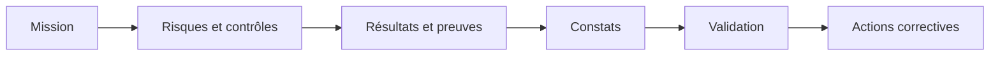

# AuditSphere

Plateforme d'audit interne : préparez vos missions, exécutez les contrôles, conservez les preuves, rédigez les constats et suivez les actions correctives jusqu'à leur clôture.

## Ce que vous pouvez faire

- **Piloter vos missions** : équipe, dates, statut et retards, dans un répertoire avec recherche et filtres.
- **Préparer le programme** : risques évalués en probabilité et impact, contrôles rattachés aux risques.
- **Tracer le travail** : résultats justifiés, preuves privées, historique des décisions.
- **Valider à quatre yeux** : la mission est approuvée par un validateur distinct de l'équipe.
- **Suivre les corrections** : actions confiées aux audités, échéances, justificatifs et vérification.
- **Lire les indicateurs** : résultats des contrôles, gravité des constats, matrice des risques et avancement des actions.

## Documentation

Le [guide d'utilisation](docs/guide-utilisateur.md) décrit les rôles, les parcours et les indicateurs.
