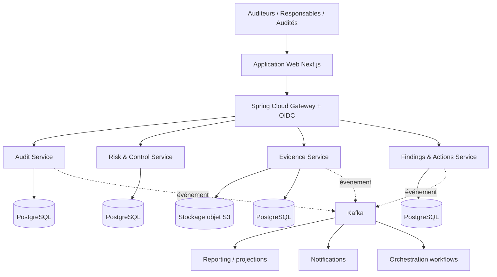

# 04 : Architecture logicielle

**Statut :** Proposé : architecture cible, non implémentée

## Orientation confirmée

Microservices Spring Boot, Kafka et Kubernetes font partie de l’objectif technique demandé. [Stack détaillée](../technique/03-stack.md) et [ADR-0002](../decisions/ADR-0002-stack-spring-distribuee.md). Chaque service est déployable indépendamment, les étapes ci-dessous indiquent l’ordre de construction.

## Style architectural

- Architecture par domaines (*bounded contexts*) et API explicites.
- Communications synchrones REST (éventuellement gRPC si besoin mesuré).
- Événements asynchrones Kafka pour les changements métier et projections.
- Bases propriétaires par contexte, transaction locale et cohérence éventuelle entre contextes.
- Application interne derrière une couche IAM centralisée.

## Vue logique cible

## Responsabilités cibles

| Contexte | Responsabilité | MVP |
| --- | --- | --- |
| Identité & accès | SSO, rôles et décisions d'autorisation | Intégration Keycloak + permissions applicatives |
| Audit | Missions, affectations, programmes | Oui |
| Risk & Control | Risques, contrôles, référentiels | Oui |
| Evidence | Métadonnées, versions, empreintes, stockage | Oui |
| Findings & Actions | Constats, recommandations, plans et échéances | Oui |
| Workflow | Validation multi-étapes, timers et escalades | Plus tard |
| Reporting | Vues consolidées, exports, projections | MVP simple, dédié ensuite |
| Continuous Audit | Connecteurs en lecture, moteur de règles, replay | Hors MVP |

## Stratégie de construction

**Étape A :** quatre frontières métier explicites, interfaces stables, déploiement local Docker Compose.  
**Étape B :** Kafka / outbox pour événements utiles et services secondaires (notifications, reporting).  
**Étape C :** Kubernetes, autoscaling mesuré, Temporal pour le scénario de validation durable et de reprise sur panne.  

Ne pas adopter une base distribuée ou du multi-région tant qu'un besoin réel ne le justifie pas.

## Décisions en attente

- Monorepo recommandé, initialisation et découpage des pipelines à réaliser.
- Stratégie de déploiement réelle (on-premise, cloud privé, cloud public).
- Gestion des migrations entre services et contrats.
- Contrats Kafka, partitionnement, rétention et tests de redélivrance à préciser.
