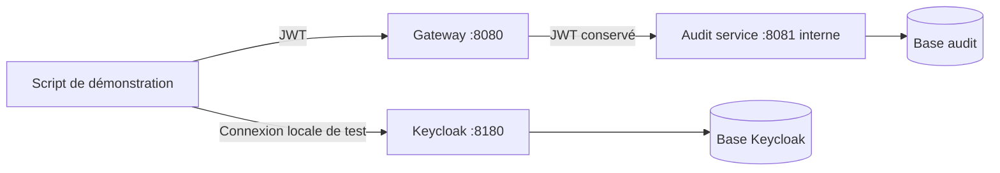

# Premier jalon : missions et permissions

**Date :** 2026-10-16  
**État :** socle API implémenté et vérifié localement, interface et déploiement distant à réaliser.

## Architecture livrée

Deux applications Java 21 / Spring Boot 3.5.16, BOM Spring Cloud 2025.0.3, Maven Wrapper 3.9.14. PostgreSQL 17.9 et Keycloak 26.8.0 sont épinglés dans Compose. Les versions sont les versions testées de ce jalon, pas une promesse de dernière version disponible. Les actualisations feront l’objet de tests et d’une revue des avis de sécurité.



Seuls les ports gateway et Keycloak sont publiés, sur `127.0.0.1`. Les deux bases ont des comptes et mots de passe distincts. Les applications tournent dans des conteneurs non root. Les données sont conservées dans des volumes nommés.

## API et règles

Contrat : [audit-api.yaml](../../../contracts/audit-api.yaml).

- `POST /missions` exige `AUDIT_MANAGER`, valide les données et déduit le créateur du `sub` du jeton.
- `GET /missions/{id}` autorise le créateur ou un sujet affecté, sans privilège de lecture globale implicite pour les responsables.
- Les missions inaccessibles renvoient `404`, comme les identifiants inexistants.
- Statut initial unique `DRAFT`. Titre, description, périmètre, créateur, affectations et horodatage sont persistés.
- La gateway valide le JWT, puis le service valide à nouveau le JWT et les droits métier.
- Signature, expiration, issuer et audience `auditsphere-api` sont contrôlés. Le CSRF est désactivé pour ces API stateless utilisant explicitement le bearer token, revoir cette décision lors de l’ajout de sessions cookies/BFF.

## Démarrage et arrêt

Depuis la racine du projet :

```bash
python3 scripts/init-local.py
docker compose up -d --build
python3 scripts/smoke.py
```

La configuration générée est privée et ignorée par Git. Le script ne l’écrase pas si elle existe. Keycloak importe les utilisateurs de démonstration une seule fois, les identifiants `sub` de test sont stables. Le script smoke attend la disponibilité, utilise de vrais jetons et ne les affiche jamais.

```bash
./mvnw -B verify
docker compose ps
docker compose logs --tail=100
docker compose down
```

`down` conserve les volumes. Ne pas utiliser `down -v` sur des données à conserver. Les mots de passe initiaux PostgreSQL et les utilisateurs importés ne sont pas renouvelés par une simple modification de `.env`.

## Vérifications effectuées

- Compilation Maven des deux applications réussie, images construites avec JDK 21.
- Sept tests d’intégration sur PostgreSQL Testcontainers : migration Flyway, création/lecture persistante, isolation d’un responsable non affecté, refus sans rôle, refus sans authentification, validation des entrées, mapping du rôle depuis un JWT signé et refus de JWT expiré/issuer incorrect/audience incorrecte (certains scénarios regroupés dans un test).
- Démonstration via gateway et Keycloak réussie : création `201`, créateur et affecté `200`, extérieur `404`, jeton absent/invalide `401`, création par auditeur `403`, titre vide `400`.
- Fichier Compose validé, cinq conteneurs démarrés sur le Mac de développement.
- `.env` et `.local/realm.json` bien exclus de Git.
- Workflow GitHub Actions écrit, aucune exécution distante n’a été effectuée, aucun remote GitHub créé.

## Limites et suite

Le frontend Next.js n’est pas encore implémenté. L’existence des sujets affectés n’est pas vérifiée auprès de Keycloak. Les dates métier, transitions de statuts, modifications d’affectations et piste d’audit complète restent à développer. Il n’y a pas encore de test de charge, Kafka, Temporal ou Kubernetes.

Le client Keycloak local autorise le grant mot de passe pour le script de démonstration uniquement. La vraie interface devra utiliser Authorization Code + PKCE ou un BFF, avec politique cookies/CSRF adaptée. HTTP et `start-dev` ne doivent pas être déployés en production. Les endpoints Actuator exposent seulement health/info, aucun endpoint métier n’est public.

Aucun changement ni déploiement de ce projet n’a été effectué sur le serveur SSH audité précédemment. Une sauvegarde externe reste à définir avant utilisation de données réelles.
