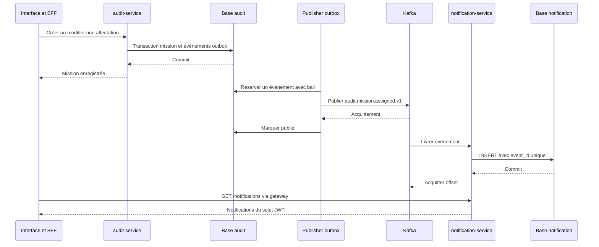

# Notifications d’affectation avec Kafka

**Date :** 2026-10-17
**Statut :** implémenté localement, vérifications détaillées ci-dessous

## Parcours utilisateur

Le responsable crée une mission avec un auditeur ou ajoute un auditeur à une mission existante. L’auditeur ouvre Notifications depuis la cloche de l’en-tête, à droite. Ce lien reste visible sur mobile, avec un libellé accessible et un état actif sur la page Notifications. Une notification permet de consulter la mission. La liste visible se rafraîchit sur signal temps réel, avec une relecture de secours toutes les 30 secondes sur la première page. Un bouton Actualiser permet de relancer immédiatement la lecture. Les pages contiennent 20 éléments.

Les missions et affectations antérieures à la migration ne sont pas rétroactivement notifiées. Un remplacement identique ne produit rien. Un retrait puis une réaffectation produit un nouvel événement. Une notification historique reste visible après retrait, mais le lien vers la mission applique les permissions actuelles et peut retourner 404. Aucun titre ni détail métier n’est stocké dans une notification.

## Flux et propriété des données



Le contrat du message est dans contracts/mission-assigned-v1.schema.json et le contrat HTTP dans contracts/notification-api.yaml. Le BFF garde les jetons côté serveur et conserve les limites de débit. La gateway et notification-service vérifient signature, expiration, émetteur et audience auditsphere-api. Le sujet vient uniquement du JWT, aucun paramètre fourni par le navigateur ne choisit le destinataire.

## Installation et bases

Exécuter sh scripts/start-local.sh. Le lanceur génère les nouveaux secrets sans remplacer les anciens, sauvegarde les bases applicatives, prépare les comptes, crée le topic, construit les services et exécute les migrations séparées. La migration audit V3 ajoute assignment_outbox. Le nouveau service a sa propre migration V1 et aucune clé étrangère interservices.

Kafka utilise apache/kafka:4.0.2 en KRaft, un volume durable et trois partitions. Le topic est créé explicitement, la création automatique est désactivée. Un conteneur ponctuel prépare les droits du volume pour UID 1000. Le broker ne tourne pas en root et aucun port Kafka n’est publié sur le Mac.

Dans pgAdmin, ajouter la base notification sur 127.0.0.1:5547, Maintenance database notification, utilisateur notification_runtime et mot de passe NOTIFICATION_RUNTIME_PASSWORD dans .env. Le compte dispose de SELECT et INSERT sur notifications, ainsi que UPDATE limité à la colonne read_at. La maintenance utilise notification_admin et NOTIFICATION_ADMIN_PASSWORD. notification_migrator possède le schéma et réalise les migrations, sans privilèges de superutilisateur. Le profil de production retire aussi le port 5547.

## Reprise et limites

Le publisher traite une ligne par passage, avec un délai de 500 ms après chaque traitement. Il ne constitue pas un mécanisme dimensionné pour un fort débit. Son appel Kafka est borné et ne retient pas de transaction SQL. Le bail empêche deux workers de traiter simultanément une ligne tant qu’il reste valide. Un acquittement perdu ou un bail expiré peut produire un doublon, éliminé par event_id côté consommateur.

Le consommateur utilise ack-mode record et désactive l’auto-commit Kafka. Les erreurs PostgreSQL provoquent une nouvelle tentative toutes les deux secondes, sans acquittement ni suppression. Les erreurs de format, de désérialisation et de validation sont transférées dans le topic source suffixé .DLT, à la même partition, avec acquittement confirmé du producteur. Une publication DLT échouée est retentée. Le message valide suivant peut ensuite être traité. La rétention DLT est de sept jours. Les alertes et le rejeu supervisé restent à préparer. Les notifications sont limitées au canal interne, sans email. Le compteur de non-lues et le marquage comme lue sont décrits ci-dessous.

Kafka conserve les événements sept jours. Une panne de consommation au-delà de la rétention, une perte du volume unique ou une suppression manuelle peut perdre des événements. Les lignes outbox publiées sont conservées pour permettre une reprise opérateur future, sans outil de rejeu général livré. Purge, sauvegarde Kafka, restauration coordonnée et politique de rétention des notifications restent à définir.

Le profil HTTPS existant ne sécurise pas Kafka. TLS, authentification, ACL par service, réplication et supervision sont requis avant une publication réelle. Aucun déploiement de production n’a été effectué.

## Vérification reproductible

```bash
./mvnw -B verify
python3 scripts/smoke.py
python3 scripts/test-notifications.py
python3 scripts/test-notifications.py --faults
npm --prefix apps/web run build
npm --prefix apps/web run test:e2e
```

L’option --faults arrête brièvement notification-service, Kafka puis notification-db, et les redémarre dans un bloc de restauration même en cas d’erreur. Lancer sur un environnement local de test. Les missions synthétiques et notifications sont conservées. Le rejeu touche exclusivement l’événement de la mission créée par le script.

Les vérifications couvrent la transaction mission et outbox, le rollback, les affectations inchangées, les conflits, les baux expirés, les retries hors transaction, la déduplication concurrente, la pagination et l’isolation par sujet. Le script utilise de vrais JWT et Kafka, vérifie les pannes du broker, du consommateur et de sa base, puis la reprise sans doublon. Playwright vérifie l’affectation, la notification, le lien vers la mission, l’isolation, l’absence de jeton dans les requêtes du navigateur et l’affichage des indisponibilités.

Résultats locaux : 29 tests Java réussis, 10 scénarios navigateur réussis dans la dernière passe complète, build Next.js réussi et script de résilience réussi pour les trois pannes. Les droits du compte notification_runtime ont été vérifiés sur une connexion TCP réelle : aucun privilège administrateur, création de table, lecture de l’historique Flyway et suppression de notifications refusées. Aucun secret détecté dans les fichiers candidats à Git par Gitleaks et comparaison avec les secrets locaux.

Le workflow CI inclut ces vérifications. Le précédent jalon de durcissement a une CI verte sur le commit 69de451. La CI de cette nouvelle tranche reste à exécuter après publication.

## Références

- [Image Docker officielle Apache Kafka](https://kafka.apache.org/40/getting-started/docker/)
- [Gestion des erreurs Spring Kafka](https://docs.spring.io/spring-kafka/reference/kafka/annotation-error-handling.html)
- [Décision outbox et notifications](../decisions/ADR-0007-notifications-outbox.md)

Déplacement vers l’en-tête vérifié : compilation Next.js réussie, deux scénarios navigateur de notifications réussis et contrôle du lien à 1280 px et 375 px, avec navigation et état actif.

## Notifications lues et non lues

La migration V2 ajoute read_at nullable et un index partiel par destinataire pour les non-lues. Les notifications existantes sont conservées et initialement non lues. Ouvrir la liste ne change pas cet état. Cliquer sur le nom de mission dans une notification enregistre sa première date de lecture, actualise le compteur puis ouvre la mission. Consulter une mission depuis un autre écran ne marque pas ses notifications. Il n’existe pas encore d’action pour revenir à non lue. Le marquage groupé est décrit dans la section Tout marquer comme lu.

La cloche de l’en-tête affiche le nombre total de non-lues, toutes pages confondues. Le badge disparaît à zéro et affiche 99+ au-delà de 99, avec le nombre exact dans son libellé accessible. Il se rafraîchit toutes les 30 secondes lorsque la page est visible, au retour sur l’onglet, après chargement de la liste et après un clic ayant enregistré la lecture. En cas d’indisponibilité, le badge est masqué plutôt que d’annoncer zéro. Une erreur de marquage est affichée sans déclarer la notification lue.

GET /notifications/unread-count filtre exclusivement par le sujet du JWT. PUT /notifications/{id}/read applique le même filtre dans la requête UPDATE et retourne 404 aussi bien pour une notification absente que pour celle d’un autre utilisateur. Le BFF exige la session, une origine exacte et le jeton CSRF. Il ne transmet ni corps arbitraire ni destinataire fourni par le navigateur.

Le marquage est idempotent : un second appel conserve la première date. Le consommateur Kafka ignore les event_id déjà présents, y compris après lecture, sans réinitialiser read_at. Les droits PostgreSQL UPDATE ne concernent que cette colonne. Le lanceur applique ces droits après migration, y compris sur une installation neuve.

Validation de la lecture : sept tests du service notifications et trois tests gateway réussis, deux scénarios navigateur ciblés réussis, contrôle TypeScript et build Next.js réussis. Les tests vérifient le compteur au-delà de la première page, la persistance après rechargement, le rejeu conservant la date, les requêtes CSRF invalides et le refus d’accès aux notifications d’autrui. Une connexion SQL runtime a confirmé UPDATE sur read_at et le refus de modifier le destinataire, la mission ou de supprimer une notification. Avant publication, la suite complète a réussi : 31 tests Java et 10 scénarios navigateur.

## Demandes de validation

Le même service consomme maintenant audit.mission.review-requested.v1. Les anciennes notifications restent de type affectation. La page Votre activité distingue les deux motifs et conserve les règles de lecture, compteur et accès par destinataire. Voir le [guide des notifications de validation](15-notifications-validation.md).

## Présentation et lecture au clic : 2026-10-19

Les notifications sont triées côté serveur par received_at décroissant, puis event_id décroissant en cas d’égalité, avant pagination. La colonne Date affiche la réception avec l’heure, afin de correspondre à cet ordre même après une livraison retardée. La colonne Lecture est supprimée. Le badge Non lue et la distinction visuelle des lignes sont conservés.

La colonne Mission affiche le titre actuel, chargé par le BFF avec le jeton du lecteur. Seules les missions distinctes de la page sont demandées, au maximum vingt, dans une requête groupée vers /missions/titles, bornée à cinq secondes. Aucun cache partagé ni titre persisté dans Kafka n’est ajouté. Un accès retiré, une mission absente ou une indisponibilité affiche Mission indisponible sans divulguer le titre.

Au clic sur le lien, le BFF conserve le contrôle CSRF. La navigation attend la réussite du marquage puis déclenche la mise à jour du compteur. Une notification déjà lue s’ouvre sans nouvelle écriture. En cas d’échec, l’utilisateur reste sur la liste avec une erreur et peut réessayer. La lecture ne donne aucun droit supplémentaire sur la mission.

Validation de cette évolution : compilation Next.js et deux scénarios navigateur réussis. Vérification du titre, du tri, de la lecture persistée et idempotente, du compteur, des erreurs de marquage, du CSRF et du masquage du titre après retrait d’accès. Les missions temporaires créées par ces tests ont été retirées, sans supprimer les six missions de démonstration.

## Action visible dans la liste

Chaque ligne est cliquable à la souris. Le nom de la mission reste dans sa colonne. Une colonne distincte à droite contient l’action compacte Ouvrir avec une flèche, sans bordure permanente. Son libellé accessible inclut le nom de la mission. Le survol et le focus mettent la ligne en évidence. Le lien reste accessible au clavier et conserve le marquage avant navigation. Une indication au-dessus du tableau explique le comportement.

Compilation réussie, clic sur la ligne et activation clavier vérifiés dans le navigateur avec marquage simulé, sans modifier les notifications de démonstration. Une seule requête de lecture par activation est vérifiée.

## Mise à jour en direct : 2026-10-19

Un flux EventSource vers /api/notifications/stream est partagé par la cloche et la liste dans chaque onglet. Le BFF relaie /notifications/stream avec le jeton côté serveur. Après insertion validée ou marquage comme lu, le sujet concerné reçoit un signal qui actualise le compteur et la page de notifications affichée. La pagination n’est pas déplacée automatiquement, les nouvelles notifications sont en première page.

Le flux est fermé après vingt-cinq secondes, à expiration du jeton ou lorsque l’onglet devient masqué. La reconnexion vérifie à nouveau la session, puis recharge les données. Une vérification toutes les trente secondes reste un secours. Aucun mot de passe, jeton, titre ni identifiant d’un autre utilisateur n’est transporté dans le signal.

Cette diffusion couvre l’instance locale actuelle. Les limites, le comportement sous saturation et l’évolution vers plusieurs instances sont précisés dans [ADR-0012](../decisions/ADR-0012-notifications-temps-reel.md).

Validation : dix tests Java du service notifications, trois scénarios navigateur et compilation Next.js réussis. Le test de réception exige une mise à jour en moins de huit secondes, avant le rafraîchissement périodique. Les scénarios créent des données temporaires retirées après vérification, sans modifier les six missions de démonstration.

La reconnexion se déclenche aussi lors du retour du réseau. Le chargement groupé des titres conserve le filtrage par droits et limite les appels lors des mises à jour en direct.

## Tout marquer comme lu : 2026-10-24

La page Notifications propose le bouton Tout marquer comme lu, à côté d’Actualiser. Il marque en une requête toutes les notifications non lues de l’utilisateur, toutes pages confondues. Un message indique le nombre de notifications marquées, ou l’absence de notification non lue. Le compteur de l’en-tête et la liste sont ensuite rechargés. Le bouton est désactivé pendant l’opération et pendant l’ouverture d’une notification.

PUT /notifications/read-all filtre exclusivement par le sujet du JWT. Un paramètre recipientSubject est ignoré. La requête ne modifie que les lignes dont read_at est vide : les dates de première lecture déjà enregistrées sont conservées. Le service renvoie le nombre de lignes modifiées et émet le signal SSE uniquement si ce nombre est positif. Le BFF expose PUT /api/notifications/read-all avec la session, l’origine exacte et le jeton CSRF, sans corps transmis. Les droits PostgreSQL existants suffisent, aucune migration n’est nécessaire.

Limite connue : le marquage groupé n’a pas d’annulation. Les notifications reçues après le clic restent non lues.

Validation : onze tests du service notifications réussis, dont un test dédié qui vérifie le refus anonyme, l’isolation entre destinataires, l’idempotence et la conservation d’une date de lecture antérieure. Contrôle TypeScript réussi. Quatre scénarios navigateur de notifications réussis contre le frontend de développement et l’image notification-service reconstruite. Le nouveau scénario vérifie le refus sans jeton CSRF, le message de résultat, la disparition du badge et des mentions Non lue, la persistance après rechargement et le second clic sans effet. Rendu vérifié sur bureau et à 375 pixels de large. Le build Next.js n’a pas été relancé pour ne pas interférer avec le serveur de développement en cours.

Le scénario utilise le compte outsider comme destinataire. Avec le compte auditor, déjà sollicité par les autres scénarios, la vérification de session échouait en fin de suite alors que le scénario seul réussissait. Cause probable : le quota gateway de 240 requêtes par minute et par utilisateur, atteint sur le serveur de développement qui double les requêtes en mode strict React. Aucun refus 429 n’a été observé directement, mais l’échec disparaît avec un destinataire distinct. Cause confirmée le 2026-11-01 par TECH-011 : dix refus 429 de `/account/security` relevés pendant une suite complète, voir le [durcissement](08-durcissement.md). Le nettoyage de fin de suite redémarre audit-service et workflow-worker. Une gateway redémarrée avant chaque passe, comme dans scripts/test-browser-isolated.sh, évite de cumuler les quotas entre passes.

## Codes d’erreur derrière la chaîne de sécurité : 2026-10-30

Dans un vrai Tomcat, une `ResponseStatusException` est rendue par un second passage sur `/error`, de type `ERROR`. Le lot 4 de remediation-service a montré qu’une chaîne terminée par `anyRequest().denyAll()` refuse ce passage : un 400 ou un 404 devient alors un 403. MockMvc ne rejoue pas ce passage et ne le montre pas.

notification-service n’a pas ce défaut. Sa chaîne se termine par `anyRequest().authenticated()`, comme audit-service. Le contexte de sécurité du JWT reste attaché à la requête pendant le passage sur `/error`, qui est donc accepté. `SecurityConfig` n’a pas été modifié.

`ErrorDispatchTest` démarre le service sur un port aléatoire avec un `JwtDecoder` de test en `@Primary`. Il exige 400 sur `/notifications?page=-1` et `/notifications?size=0`, 404 sur le marquage d’une notification inconnue et 200 sur la liste. Il protège contre un futur passage à `denyAll()` sans règle pour le type `ERROR`.

Vérifié localement avec JDK 25 et Docker : le test réussit sur la configuration actuelle. Avec une chaîne modifiée temporairement pour finir par `denyAll()`, il échoue avec `expected: <400> but was: <403>`, ce qui prouve qu’il détecte le défaut. Modification retirée ensuite. `./mvnw -B -pl services/notification-service -am verify` réussit avec 18 tests. Non vérifié : CI distante et service déployé dans k3s.

## Affectation d’une action corrective : 2026-10-30

- notification-service consomme aussi `audit.action.assigned.v1`, publié par remediation-service à la création et à la réaffectation d’une action corrective. Le destinataire est le nouveau responsable de l’action. Le précédent ne reçoit rien.
- Migration V4 : colonne `action_id`, type ajouté à la contrainte, et contrainte qui impose `action_id` pour ce type et l’interdit pour les deux autres. L’événement est validé de la même façon avant l’insertion.
- La réponse de `GET /notifications` porte `actionId`, nul pour les notifications de mission. Contrat dans `contracts/notification-api.yaml`.
- La page Votre activité affiche « Une action corrective vous est confiée ». L’audité ne voit pas la mission : le clic marque la notification lue sans naviguer, en attendant la page de l’action prévue au lot 7 des actions correctives.
- Détails et vérifications dans le [guide des actions correctives](27-actions-correctives.md).

