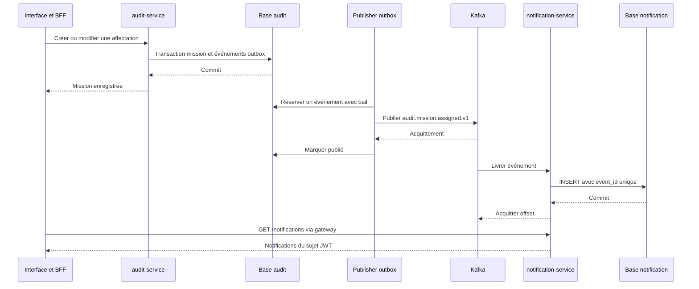

# Notifications d’affectation avec Kafka

**Date :** 2026-10-17
**Statut :** implémenté localement, vérifications détaillées ci-dessous

## Parcours utilisateur

Le responsable crée une mission avec un auditeur ou ajoute un auditeur à une mission existante. L’auditeur ouvre Notifications depuis la cloche de l’en-tête, à droite. Ce lien reste visible sur mobile, avec un libellé accessible et un état actif sur la page Notifications. Une notification permet de consulter la mission. La première page visible s’actualise toutes les 30 secondes, un bouton Actualiser permet de relancer immédiatement la lecture. Les pages contiennent 20 éléments.

Les missions et affectations antérieures à la migration ne sont pas rétroactivement notifiées. Un remplacement identique ne produit rien. Un retrait puis une réaffectation produit un nouvel événement. Une notification historique reste visible après retrait, mais le lien vers la mission applique les permissions actuelles et peut retourner 404. Aucun titre ni détail métier n’est stocké dans une notification.

## Flux et propriété des données



Le contrat du message est dans contracts/mission-assigned-v1.schema.json et le contrat HTTP dans contracts/notification-api.yaml. Le BFF garde les jetons côté serveur et conserve les limites de débit. La gateway et notification-service vérifient signature, expiration, émetteur et audience auditsphere-api. Le sujet vient uniquement du JWT, aucun paramètre fourni par le navigateur ne choisit le destinataire.

## Installation et bases

Exécuter sh scripts/start-local.sh. Le lanceur génère les nouveaux secrets sans remplacer les anciens, sauvegarde les bases applicatives, prépare les comptes, crée le topic, construit les services et exécute les migrations séparées. La migration audit V3 ajoute assignment_outbox. Le nouveau service a sa propre migration V1 et aucune clé étrangère interservices.

Kafka utilise apache/kafka:4.0.2 en KRaft, un volume durable et trois partitions. Le topic est créé explicitement, la création automatique est désactivée. Un conteneur ponctuel prépare les droits du volume pour UID 1000. Le broker ne tourne pas en root et aucun port Kafka n’est publié sur le Mac.

Dans pgAdmin, ajouter la base notification sur 127.0.0.1:5547, Maintenance database notification, utilisateur notification_runtime et mot de passe NOTIFICATION_RUNTIME_PASSWORD dans .env. Le compte dispose de SELECT et INSERT sur notifications uniquement. La maintenance utilise notification_admin et NOTIFICATION_ADMIN_PASSWORD. notification_migrator possède le schéma et réalise les migrations, sans privilèges de superutilisateur. Le profil de production retire aussi le port 5547.

## Reprise et limites

Le publisher traite une ligne par passage, avec un délai de 500 ms après chaque traitement. Il ne constitue pas un mécanisme dimensionné pour un fort débit. Son appel Kafka est borné et ne retient pas de transaction SQL. Le bail empêche deux workers de traiter simultanément une ligne tant qu’il reste valide. Un acquittement perdu ou un bail expiré peut produire un doublon, éliminé par event_id côté consommateur.

Le consommateur utilise ack-mode record et désactive l’auto-commit Kafka. Les erreurs PostgreSQL ou de format provoquent une nouvelle tentative toutes les deux secondes, sans acquittement ni suppression. Un message incompatible bloque sa partition jusqu’à intervention, la quarantaine et les alertes sont des travaux futurs. Les notifications sont limitées au canal interne, sans email, badge de non-lus ou marquage comme lu.

Kafka conserve les événements sept jours. Une panne de consommation au-delà de la rétention, une perte du volume unique ou une suppression manuelle peut perdre des événements. Les lignes outbox publiées sont conservées pour permettre une reprise opérateur future, sans outil de rejeu général livré. Purge, sauvegarde Kafka, restauration coordonnée et politique de rétention des notifications restent à définir.

Le profil HTTPS existant ne sécurise pas Kafka. TLS, authentification, ACL par service, réplication et supervision sont requis avant une publication réelle. Aucun déploiement de production n’a été effectué.

## Vérification reproductible

```bash
./mvnw -B verify
python3 scripts/smoke.py
python3 scripts/test-notifications.py
python3 scripts/test-notifications.py --faults
npm --prefix apps/web run build
npm --prefix apps/web run test:e2e
```

L’option --faults arrête brièvement notification-service, Kafka puis notification-db, et les redémarre dans un bloc de restauration même en cas d’erreur. Lancer sur un environnement local de test. Les missions synthétiques et notifications sont conservées. Le rejeu touche exclusivement l’événement de la mission créée par le script.

Les vérifications couvrent la transaction mission et outbox, le rollback, les affectations inchangées, les conflits, les baux expirés, les retries hors transaction, la déduplication concurrente, la pagination et l’isolation par sujet. Le script utilise de vrais JWT et Kafka, vérifie les pannes du broker, du consommateur et de sa base, puis la reprise sans doublon. Playwright vérifie l’affectation, la notification, le lien vers la mission, l’isolation, l’absence de jeton dans les requêtes du navigateur et l’affichage des indisponibilités.

Résultats locaux : 29 tests Java réussis, 10 scénarios navigateur réussis dans la dernière passe complète, build Next.js réussi et script de résilience réussi pour les trois pannes. Les droits du compte notification_runtime ont été vérifiés sur une connexion TCP réelle : aucun privilège administrateur, création de table, lecture de l’historique Flyway et suppression de notifications refusées. Aucun secret détecté dans les fichiers candidats à Git par Gitleaks et comparaison avec les secrets locaux.

Le workflow CI inclut ces vérifications. Le précédent jalon de durcissement a une CI verte sur le commit 69de451. La CI de cette nouvelle tranche reste à exécuter après publication.

## Références

- [Image Docker officielle Apache Kafka](https://kafka.apache.org/40/getting-started/docker/)
- [Gestion des erreurs Spring Kafka](https://docs.spring.io/spring-kafka/reference/kafka/annotation-error-handling.html)
- [Décision outbox et notifications](../decisions/ADR-0007-notifications-outbox.md)

Déplacement vers l’en-tête vérifié : compilation Next.js réussie, deux scénarios navigateur de notifications réussis et contrôle du lien à 1280 px et 375 px, avec navigation et état actif.
