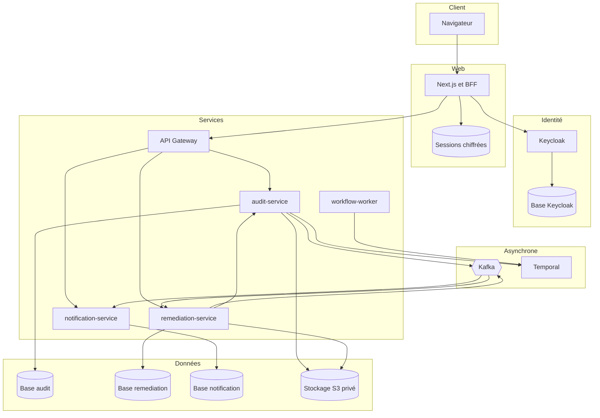
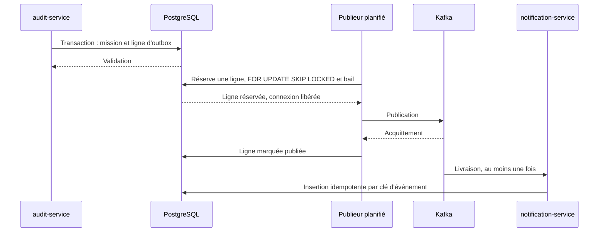
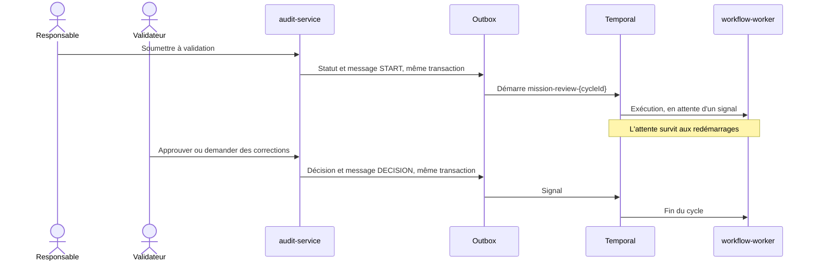
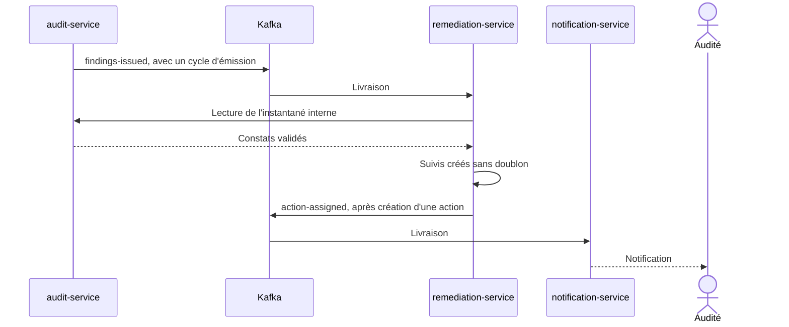
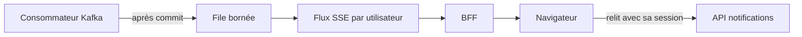

# Architecture

AuditSphere suit un découpage par domaine. Chaque service possède ses données et les autres n'y accèdent que par API ou événement.

## Vue d'ensemble



## Responsabilités

| Composant | Rôle | Données |
| --- | --- | --- |
| `apps/web` | Interface et BFF : session, CSRF, relais vers les API autorisées | Sessions chiffrées |
| `api-gateway` | Point d'entrée : routage, limites de débit, contrôle de révocation des comptes | Aucune |
| `audit-service` | Missions, équipes, programme, résultats, preuves, constats et administration des comptes | Base audit, bucket des preuves |
| `workflow-worker` | Même image qu'`audit-service`, lancée comme processus Temporal séparé | État porté par Temporal |
| `remediation-service` | Suivis des constats, actions correctives, justificatifs et leur journal | Base remediation, bucket des justificatifs |
| `notification-service` | Notifications persistées et flux temps réel | Base notification |
| Keycloak | Source des identités et des rôles | Base dédiée |

Chaque service valide lui-même le JWT. La gateway ne constitue pas la seule barrière.

## Communication entre services

| Besoin | Moyen | Raison |
| --- | --- | --- |
| Requête d'un utilisateur | REST synchrone par la gateway | Réponse immédiate et droits vérifiés à chaque appel |
| Diffuser un fait métier | Kafka avec outbox | Consommateurs découplés et livraison au moins une fois |
| Attendre une décision humaine | Temporal | État durable sur une longue période |
| Prévenir un navigateur | Server-Sent Events | Sens unique, sans donnée métier dans le signal |
| Copier un constat émis | Événement puis lecture interne | Message sans contenu sensible et copie cohérente |

Kafka ne remplace pas Temporal. Les événements annoncent ce qui s'est passé, le workflow suit ce qui reste à faire.

## Outbox transactionnelle



Si le publieur s'arrête après l'envoi, la ligne est reprise à la fin du bail. Le message peut alors être publié deux fois. L'idempotence du consommateur absorbe ce doublon. Les messages illisibles sont envoyés vers un topic `.DLT` au lieu de bloquer la partition. Une panne temporaire est réessayée sans limite pour ne perdre aucun événement.

## Événements

| Topic | Producteur | Consommateur | Effet |
| --- | --- | --- | --- |
| `audit.mission.assigned.v1` | audit-service | notification-service | Prévient un auditeur affecté |
| `audit.mission.review-requested.v1` | audit-service | notification-service | Prévient le validateur |
| `audit.action.assigned.v1` | remediation-service | notification-service | Prévient l'audité |
| `audit.mission.findings-issued.v1` | audit-service | remediation-service | Ouvre les suivis des constats validés |
| `audit.mission.findings-withdrawn.v1` | audit-service | remediation-service | Suspend ou retire les suivis |

Les schémas sont versionnés dans [contracts/](../contracts). Les messages, les journaux techniques et les métriques ne contiennent ni le texte des constats ni celui des actions.

## Validation durable d'une mission



PostgreSQL reste la référence des droits et des statuts. Une réponse HTTP réussie signifie que la décision métier est enregistrée, sa transmission à Temporal étant garantie par l'outbox. Une nouvelle soumission crée un nouveau cycle, ce qui évite de réutiliser un workflow terminé.

## Des constats aux actions correctives



Le suivi démarre à l'approbation de la mission, et non à la validation d'un constat, car un constat validé peut encore être rouvert tant que la mission est En cours. Une réouverture suspend les suivis, puis une nouvelle approbation les réconcilie grâce au cycle d'émission.

## Temps réel



Le signal ne contient que `refresh`. Le navigateur relit ensuite ses données par l'API habituelle, qui contrôle les droits. Une file bornée sur un thread séparé empêche un navigateur lent de bloquer Kafka ou une transaction. Le signal peut se perdre sans conséquence, car les notifications sont persistées.

## Concurrence et cohérence

- **Verrou de mission** : les écritures sensibles sérialisent les transitions de statut d'une mission.
- **Verrou optimiste** : chaque modification transmet une version, et un formulaire périmé reçoit un conflit 409.
- **Transactions locales** : aucune transaction distribuée. La cohérence entre services est éventuelle et explicite.
- **Compteurs bornés** : des quotas limitent les risques, contrôles, constats, preuves et volumes par mission.

## Organisation du dépôt

```text
apps/web/         Interface Next.js, BFF et parcours Playwright
services/         api-gateway, audit-service, notification-service, remediation-service
contracts/        OpenAPI et JSON Schema
infra/helm/       Charts des services, de Keycloak, du frontend et de la réinitialisation
deploy/k3s/       Manifestes du cluster : données, supervision, sauvegardes, réseau
scripts/          Démarrage local, tests de panne, déploiement, sauvegarde et restauration
```
