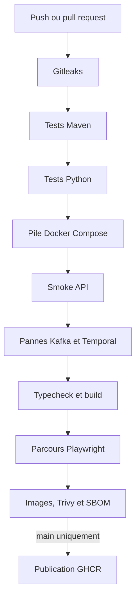
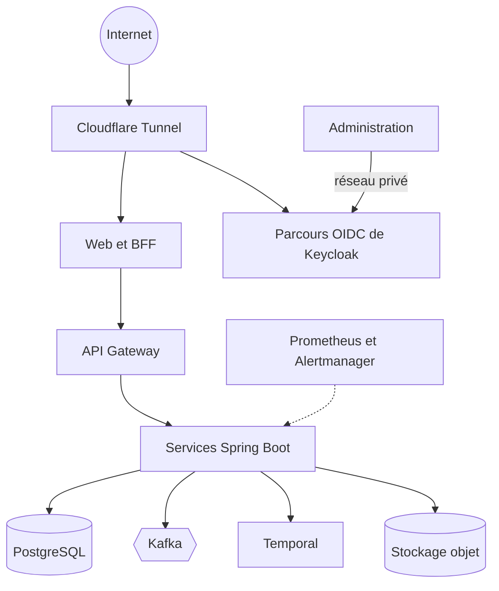
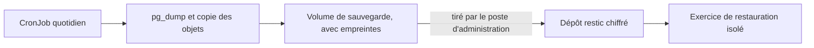

# Exploitation

Ce document décrit comment AuditSphere est testé, livré, déployé et surveillé.

## Intégration continue

Le [workflow](../.github/workflows/ci.yml) exécute le système réel et non des simulations : PostgreSQL, Kafka, Keycloak, Temporal et le stockage objet démarrent pour de vrai.

## Stratégie de test

| Niveau | Outils | Ce qui est vérifié |
| --- | --- | --- |
| Unitaire et intégration | JUnit 5, Testcontainers, Awaitility | Règles métier, droits, migrations, consommateurs |
| Contrôles d'infrastructure | Python unittest | Épinglage des images, droits SQL, configuration d'identité |
| Smoke | [smoke.py](../scripts/smoke.py) | API principales avec de vrais JWT |
| Panne | [test-notifications.py](../scripts/test-notifications.py), [test-temporal.py](../scripts/test-temporal.py) | Reprise sans perte ni doublon |
| Parcours | Playwright | Parcours par rôle, droits refusés, mobile, états d'erreur |

Les tests navigateur sont isolés par fichier, avec un frontend neuf et une gateway redémarrée, pour que les quotas en mémoire ne faussent pas les résultats.

### Scénarios de panne

- Kafka arrêté pendant qu'une mission est créée : l'outbox conserve l'événement, puis le publie au retour.
- `notification-service` ou sa base arrêtés : la notification arrive après la reprise, une seule fois.
- `workflow-worker` arrêté pendant une revue : le workflow reprend sans décision perdue.
- Temporal redémarré : l'attente de la décision est conservée.

## Déploiement

L'environnement hébergé est un cluster k3s à un nœud, sur un serveur privé. Ce choix donne une vraie distribution Kubernetes sans coût récurrent. Les composants ont une réplique et des limites de ressources mesurées.

- **Charts Helm** : un chart générique [spring-service](../infra/helm/spring-service) et des valeurs par service.
- **Images immuables** : une image par commit, déployée par empreinte. Le retour arrière consiste à redéployer l'empreinte précédente.
- **Migrations séparées** : un compte SQL distinct exécute Flyway. Le compte d'exécution reste limité.
- **Secrets hors Git** : créés dans le cluster, jamais versionnés.
- **Profils** : un profil de démonstration à données fictives réinitialisées chaque nuit, et un profil de production sans comptes de démonstration.

## Supervision

| Besoin | Outil | Fonctionnement |
| --- | --- | --- |
| Métriques et alertes | Prometheus, Alertmanager | Permanents, réglés pour une faible consommation |
| Disponibilité | Blackbox Exporter | Sonde l'application et Keycloak depuis le cluster |
| Notification | Webhook ntfy | Alerte envoyée en notification push |
| Veille de la supervision | Healthchecks.io | Un signal régulier révèle une supervision tombée |
| Traces et journaux | OpenTelemetry, Tempo, Loki, Alloy, Grafana | Démarrés à la demande |

La pile de diagnostic n'est active que le temps d'une session d'observation, afin de respecter la mémoire disponible. Une requête peut alors être suivie de la gateway jusqu'aux services et à travers Kafka. Un [tableau de bord Grafana](../deploy/k3s/observability/dashboards/vue-ensemble.json) est versionné.

## Sauvegarde et restauration

- Le serveur ne détient ni la clé de chiffrement ni aucun accès au poste d'administration. Une compromission du serveur ne donne donc pas accès aux sauvegardes.
- L'exercice de restauration ([k3s-restore-test.sh](../scripts/k3s-restore-test.sh)) remonte les données dans un namespace isolé et contrôle les empreintes des preuves.

## Limites connues

- Un seul nœud, donc une interruption lors d'un redémarrage ou d'une mise à jour.
- Déploiement par Helm et scripts, sans GitOps.
- Traces et journaux non conservés entre deux sessions d'observation.
- Aucun objectif de niveau de service formalisé, car l'usage reste faible.
