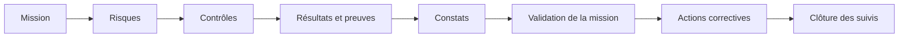
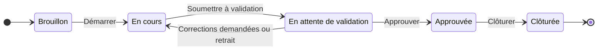
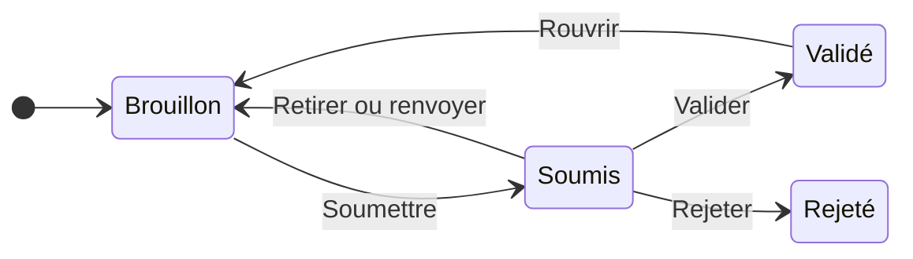
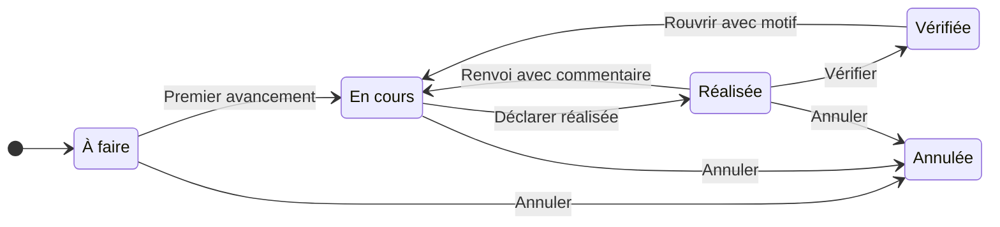
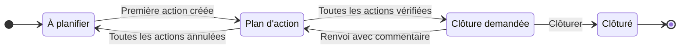

# Guide d'utilisation d'AuditSphere

AuditSphere réunit au même endroit le travail d'une mission d'audit interne : risques, contrôles, preuves, constats et actions correctives.

## Le parcours en un coup d'œil

## Qui fait quoi

Ce que vous voyez dépend de votre rôle et des missions auxquelles vous participez. Une mission à laquelle vous ne participez pas n'apparaît pas dans votre espace.

| Rôle | Ce que vous pouvez faire |
| --- | --- |
| Responsable | Créer vos missions, préparer le programme, composer l'équipe, décider sur les constats, gérer les actions correctives |
| Auditeur | Renseigner les résultats, joindre les preuves, rédiger les constats, vérifier les actions réalisées |
| Validateur | Approuver une mission ou demander des corrections, clôturer les suivis des missions où vous êtes désigné |
| Audité | Suivre les actions qui vous sont confiées, indiquer leur avancement et joindre les justificatifs |
| Superadministrateur | Accéder à toutes les missions, gérer les comptes et effectuer des dérogations motivées |

## Se repérer dans l'application

- **Missions d'audit** : le répertoire des missions accessibles, avec recherche, filtres par statut, responsable ou retard, et tri.
- **Mes actions** : pour les audités, la liste des actions à traiter.
- **Notifications** : les affectations, les demandes de validation et les actions qui vous sont confiées.
- **Tableau de bord** et **Utilisateurs** : pour les superadministrateurs.

La fiche d'une mission est organisée en onglets : Vue d'ensemble, Indicateurs, Risques, Contrôles, Constats, Équipe et Suivi. L'onglet Actions correctives apparaît une fois la mission approuvée.

Une mission est signalée en retard lorsque sa date de fin prévue est dépassée et qu'elle n'est pas clôturée.

## Le cycle de vie d'une mission

1. **Créer la mission.** Le responsable indique le titre et le périmètre, puis choisit les auditeurs et un validateur. Ces choix restent modifiables depuis la fiche.
2. **Démarrer.** Le responsable enregistre les dates prévues et démarre la mission.
3. **Soumettre à validation.** Tous les constats doivent être validés ou rejetés. Le validateur désigné doit être une personne différente du responsable et des auditeurs.
4. **Décider.** Le validateur approuve, ou demande des corrections avec un commentaire. Dans ce second cas, la mission revient En cours.
5. **Clôturer.** Le responsable clôture la mission approuvée.

Tant que le validateur n'a pas décidé, le responsable peut retirer la soumission avec un motif. Un brouillon peut être supprimé, avec confirmation et motif.

## Préparer le programme d'audit

Le programme se prépare lorsque la mission est en Brouillon ou En cours. Il est verrouillé pendant la validation et après l'approbation.

- **Risques** : ajoutez un titre et une description, puis évaluez la probabilité et l'impact sur cinq niveaux. Le filtre Sans contrôle montre les risques qui restent à couvrir.
- **Contrôles** : décrivez l'objectif et la procédure, puis rattachez le contrôle à un ou plusieurs risques. Ajouter un contrôle depuis un risque le présélectionne.

Une mission compte au maximum 100 risques et 100 contrôles.

## Renseigner les résultats et les preuves

Dans une mission En cours, un auditeur de l'équipe ouvre un contrôle et choisit sa conclusion : Conforme, Non conforme ou Non applicable. Une justification est obligatoire. Corriger un résultat remplace celui qui est affiché, l'auteur et la date restent indiqués.

Modifier un contrôle efface son résultat courant, car il doit être réexécuté.

Les preuves s'ajoutent depuis la page du contrôle.

- Formats acceptés : PDF, JPEG et PNG.
- Taille maximale : 10 Mio par fichier.
- Limites : 100 preuves par contrôle et 100 Mio par mission.

Seules les personnes ayant accès à la mission peuvent télécharger une preuve. Retirer une personne de l'équipe lui retire cet accès.

## Rédiger et décider les constats

Un auditeur crée un constat depuis l'onglet Constats, dans une mission En cours. Pour le soumettre, il doit renseigner la cause et la recommandation, et lier au moins un contrôle dont le résultat est Non conforme.

Le responsable décide ensuite :

- **Valider** le constat.
- **Renvoyer** le constat en brouillon, avec un commentaire.
- **Rejeter** le constat, avec un motif. Il reste consultable mais n'est plus modifiable.
- **Rouvrir** un constat validé, avec un motif, tant que la mission est En cours.

La personne qui a soumis un constat ne peut pas décider elle-même. L'historique de chaque constat reste consultable.

## Suivre les actions correctives

À l'approbation de la mission, chaque constat validé ouvre un suivi. Le responsable y crée les actions à mener, confie chacune à un audité et fixe une échéance.

**Si vous êtes audité.** Ouvrez Mes actions, indiquez l'avancement et joignez vos justificatifs. Pour déclarer une action réalisée, il faut un commentaire et au moins un justificatif. Vous voyez uniquement vos actions et le constat associé.

**Si vous êtes auditeur ou responsable.** Vérifiez l'action réalisée, ou renvoyez-la avec un commentaire. La personne chargée d'une action ne peut pas la vérifier elle-même.

**Si vous êtes responsable.** Vous pouvez modifier une action, changer son responsable, reporter l'échéance avec un motif ou annuler l'action avec un motif.

Une action est signalée en retard lorsque son échéance est dépassée alors qu'elle est À faire ou En cours. Le retard ne change pas son statut.

Les justificatifs acceptent les mêmes formats que les preuves, avec 10 Mio par fichier, 10 fichiers par action et 100 Mio par mission.

### Clôturer un suivi

Le responsable demande la clôture lorsque toutes les actions non annulées sont vérifiées. Le validateur désigné clôture alors le suivi, ou le renvoie avec un commentaire. La clôture d'un suivi est définitive.

## Lire les indicateurs

### Sur une mission

L'onglet Indicateurs de la fiche présente l'état de la mission.

- **Résultats des contrôles** : la part des contrôles conformes, non conformes, non applicables et sans résultat.
- **Constats par gravité** : la répartition de Faible à Critique. Les constats rejetés ne sont pas comptés.
- **Matrice des risques** : le nombre de risques pour chaque combinaison de probabilité et d'impact. La couleur indique le nombre de risques de la case, pas leur criticité. Survolez une case pour voir les titres des risques.
- **Actions correctives** : la répartition des actions par statut et le nombre d'actions en retard. Cet indicateur apparaît une fois la mission approuvée.

### Sur le tableau de bord

Les superadministrateurs retrouvent dans Tableau de bord les compteurs globaux, les cinq échéances dépassées les plus anciennes et la répartition des missions par statut. Chaque ligne de la répartition ouvre le répertoire filtré sur ce statut.

Si un indicateur ne peut pas être chargé, l'application l'indique et propose Réessayer. Elle n'affiche jamais un zéro par défaut.

## Gérer les comptes

Le superadministrateur gère les comptes depuis Utilisateurs : recherche, création, modification du profil et des rôles, désactivation et réinitialisation de l'accès. Chaque opération demande un motif et reste tracée.

- L'identifiant et l'adresse email d'un compte existant ne se modifient pas ici.
- Le mot de passe n'est jamais affiché. La personne reçoit un email pour le définir.
- Après un changement de droits, la personne doit se reconnecter.
- Désactiver un compte conserve ses affectations et son historique.

## Dérogations du superadministrateur

Le panneau de dérogation de la fiche permet d'approuver, de clôturer, de rouvrir ou de supprimer une mission en dehors du parcours habituel. Chaque dérogation exige un motif et une confirmation, et reste tracée.

Certaines règles s'appliquent toujours. Un superadministrateur ne peut pas approuver une mission dont il est responsable, validateur ou auditeur. Les constats encore en Brouillon ou Soumis bloquent aussi l'approbation et la clôture.

## En cas de difficulté

| Situation | Que faire |
| --- | --- |
| Une mission n'apparaît pas | Vous ne participez sans doute pas à cette mission. Demandez au responsable de vous ajouter à l'équipe. |
| Le message indique que l'élément a été modifié | Une autre personne a travaillé en même temps que vous. Rechargez la page puis recommencez. |
| La mission ne peut pas être soumise | Vérifiez qu'un validateur est désigné et qu'aucun constat n'est en Brouillon ou Soumis. |
| Un constat ne peut pas être soumis | Complétez la cause et la recommandation, puis liez un contrôle Non conforme. |
| Une action ne peut pas être déclarée réalisée | Ajoutez un commentaire de réalisation et au moins un justificatif. |
| Votre session a expiré | Reconnectez-vous. Vos droits ont peut-être changé. |
| Un bouton attendu n'apparaît pas | L'action dépend de votre rôle et du statut de la mission. Consultez le cycle de vie plus haut. |
