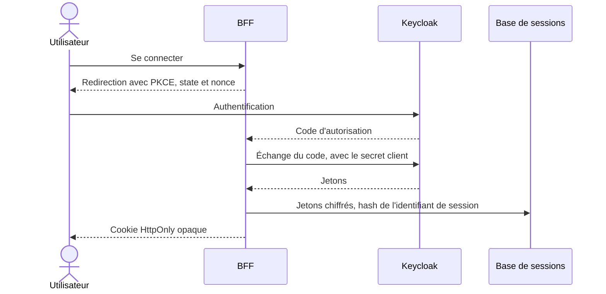

# Sécurité

La sécurité d'AuditSphere repose sur un principe simple : l'interface masque, le serveur décide. Ce document présente les mécanismes retenus et leurs limites.

## Authentification

- **Pas de jeton dans le navigateur** : le JavaScript de la page ne peut lire ni jeton d'accès ni jeton de rafraîchissement.
- **Session protégée au repos** : les jetons sont chiffrés en AES-256-GCM. Une fuite de la table ne suffit pas à rejouer un cookie, car seul son hash y figure.
- **Renouvellement sûr** : la ligne de session est verrouillée pendant le rafraîchissement, ce qui gère les requêtes concurrentes.
- **Révocation** : changer les droits d'un compte invalide ses jetons antérieurs et ferme ses sessions. La gateway et les services consultent ce registre.
- **Compte sensible** : le superadministrateur doit utiliser un second facteur en production.

## Protection des requêtes web

- Mutations soumises à une origine exacte et à un jeton CSRF de session.
- Cookies `HttpOnly`, `SameSite=Lax` et `Secure` en HTTPS.
- Content Security Policy à nonce, générée à chaque requête.
- Mesure d'audience facultative par Cloudflare Web Analytics et Umami Cloud. Sans `CF_ANALYTICS_TOKEN` ni `UMAMI_WEBSITE_ID`, aucun script tiers n'est chargé et la CSP n'autorise aucune origine externe pour les scripts ou les requêtes.
- Limites de débit au niveau du BFF et de la gateway.
- Le BFF relaie une liste fermée d'API, sans proxy générique.

## Autorisations

Deux questions sont posées à chaque requête : quel est le rôle de cette personne, et participe-t-elle à cette mission ?

| Règle | Application |
| --- | --- |
| Cloisonnement | Une mission hors périmètre renvoie 404, pour ne pas révéler son existence |
| Validation indépendante | Le validateur est distinct du responsable et des auditeurs. Un trigger PostgreSQL empêche aussi qu'il soit auditeur de la mission |
| Décision sur un constat | La personne qui l'a soumis ne peut pas le valider, le renvoyer ni le rejeter |
| Vérification d'une action | La personne chargée de l'action ne peut pas la vérifier |
| Clôture d'un suivi | La personne qui l'a demandée ne peut pas la prononcer |
| Audité | Il voit ses seules actions, sans accès au reste de la mission ni aux preuves |
| Superadministrateur | Ses dérogations exigent un motif et restent tracées. L'approbation d'une mission à laquelle il participe reste refusée |

Ces règles sont vérifiées par des tests d'API et des parcours navigateur, y compris pour un utilisateur extérieur à la mission.

## Preuves et fichiers

- Bucket privé, sans clé S3 ni URL signée transmise au navigateur.
- Chaque téléchargement repasse par le BFF puis le service, qui revérifie les droits courants.
- Formats limités à PDF, JPEG et PNG, avec des quotas par fichier, par contrôle et par mission.
- Noms de fichiers bornés, séparateurs de chemin et caractères de contrôle refusés.
- Empreinte SHA-256 conservée et recalculée au téléchargement. Une divergence interrompt le flux.

## Traçabilité

- Les changements de constats, d'actions et de comptes alimentent des journaux en ajout seul.
- Le compte SQL applicatif n'a que les droits nécessaires. Il ne peut pas réécrire l'auteur, l'action, le motif ou la date d'une opération d'administration.
- L'auteur et la date viennent du serveur, jamais du navigateur.
- Les mots de passe et les jetons n'apparaissent dans aucun journal.

## Chaîne de livraison

- Gitleaks analyse tout l'historique Git à chaque exécution de la CI.
- Trivy bloque une image qui contient une vulnérabilité élevée ou critique corrigeable.
- Un SBOM CycloneDX est produit pour chaque image.
- Les actions GitHub sont épinglées par SHA complet, ce qu'un test Python vérifie. Les images de déploiement le sont par empreinte.
- L'épinglage automatique passe par une GitHub App au jeton éphémère, limitée au contenu et aux pull requests. Aucun workflow ne détient d'accès au cluster.
- Seul un push sur `main` publie vers le registre, avec des permissions limitées à ce job.

## Isolation dans le cluster

- Trafic d'entrée refusé par défaut, puis ouvert flux par flux avec des NetworkPolicies.
- Pod Security Standards appliqués par namespace.
- TLS interne émis par cert-manager, à partir d'une autorité dont la racine reste hors ligne.
- Kafka avec authentification SASL, TLS et ACL par service. Temporal et le stockage objet sont aussi en TLS.
- Aucun port entrant ouvert sur Internet : l'exposition publique passe par un tunnel sortant.
- Seuls l'application et les parcours OIDC de Keycloak sont publics. La console d'administration reste sur le réseau privé.

## Profil de démonstration

Le profil de démonstration propose une entrée en un clic, sans mot de passe partagé. Le BFF signe une assertion JWT à usage unique et de courte durée, que Keycloak accepte pour des comptes fictifs dépourvus de droits d'administration. Les données sont réinitialisées chaque nuit.

## Revue de sécurité

Une revue interne du code a relevé 18 constats, sur les identités, les sessions, les droits SQL et le déploiement. Les constats applicatifs ont chacun reçu un correctif dédié. Le constat lié au déploiement a conduit au durcissement du cluster décrit plus haut. Cette revue ne remplace pas un test d'intrusion indépendant, qui n'a pas été mené.

## Limites connues

- Pas d'antivirus sur les fichiers déposés. Seuls le format et la taille sont contrôlés.
- La plateforme n'héberge que des données fictives. Une mise en production réelle demanderait un cadrage RGPD et des durées de conservation.
